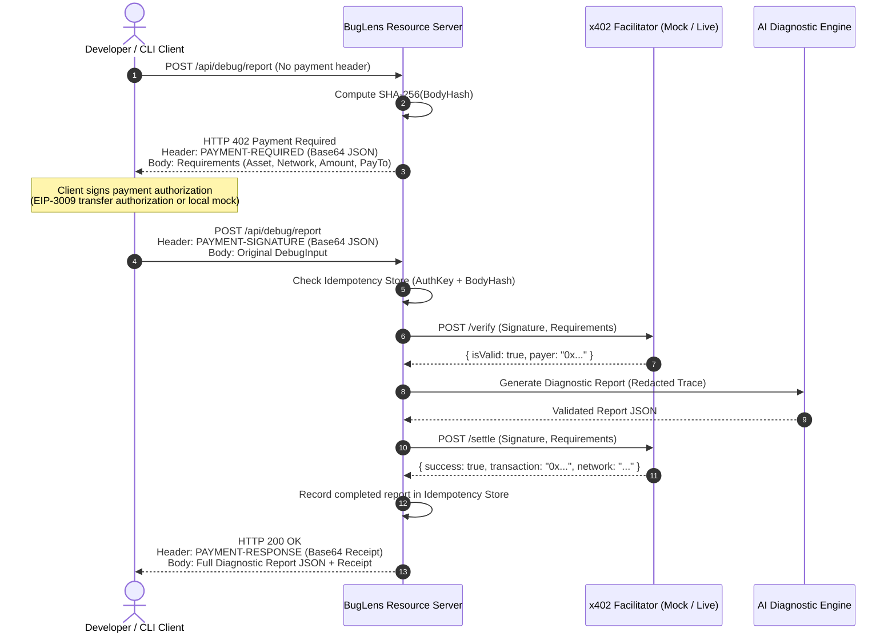

# BugLens — Pay-Per-Use Debugging Assistant (Powered by x402)

> **Teacher's Problem Statement:** *"Build an application that leverages x402 think of usecase and build. Submit the Github URL below. The project will be evaluated with same Judging to be fair for all."*

---

## 1. Problem & Use Case

Developers frequently encounter cryptic stack traces, compiler errors, or unhandled promise rejections. Traditional AI coding assistants require recurring monthly subscriptions ($20–$50/mo), full account signups, or private API keys.

**BugLens** solves this with a **discrete, pay-per-use debugging service**:
- **Zero accounts, zero subscriptions, zero browser private keys.**
- **Free deterministic analysis:** Instant error classification, application stack frame extraction, and pattern-based hints.
- **Premium structured AI debugging report:** Gated via the open **HTTP 402 Payment Required (x402)** protocol. Developers or autonomous agents pay micropayments (e.g. 0.10 USDC) per diagnostic report directly over HTTP.

---

## 2. Free vs. Paid Feature Matrix

| Feature | Free Basic Analysis (`POST /api/debug/basic`) | Paid AI Report (`POST /api/debug/report`) |
| :--- | :--- | :--- |
| **Access Control** | Unrestricted (No payment) | **x402 Payment Required (HTTP 402)** |
| **Pricing** | $0.00 | **0.10 USDC** (100,000 atomic units, eip155:84532) |
| **Error Type Classification** | Pattern-based regex parser | Deep contextual diagnosis |
| **Stack Frame Extraction** | File:line:column extraction (V8, Py, Go, Rust) | Contextual code navigation |
| **AI LLM Invocation** | **None** (Deterministic local table) | Third-party structured AI generation |
| **Root Cause Breakdown** | None | Confirmed facts vs. hypotheses |
| **Suggested Fix** | Generic static tips | Custom defensive code proposal |
| **Verification Steps** | None | Tailored unit/integration test cases |
| **Sanitization** | Server-side secret scrubbing | Server-side secret scrubbing before AI/logs |
| **Execution Disclaimer** | N/A | `suggestedFix.executed: false` ("Not executed or verified") |
| **Receipt Delivery** | None | Cryptographic payment receipt in header & body |

---

## 3. Architecture Overview

```
                      +---------------------------------------+
                      |       Developer Playground / CLI      |
                      |   (Vite + React / TypeScript Client)  |
                      +-------------------+-------------------+
                                          |
                1. GET /api/catalog       |  3. POST /api/debug/report (Unpaid)
                2. POST /api/debug/basic  |     -> Returns HTTP 402 + Requirements
                                          |  4. POST /api/debug/report (Signed)
                                          v
                      +---------------------------------------+
                      |         BugLens Express Server        |
                      |  - Security (Helmet, CORS, RateLimit) |
                      |  - Validation (Zod, Content-Type 415) |
                      |  - Secret Sanitizer (Regex scrubbing) |
                      |  - Body-Hash Idempotency Store (RAM)  |
                      +---------+-------------------+---------+
                                |                   |
             Verify Signature   |                   | Settle Transaction
             (POST /verify)     v                   v (POST /settle)
                      +-------------------+   +-----------------------+
                      |  x402 Facilitator |   |  AI Diagnostic Engine |
                      |  (Mock or HTTP)   |   |  (OpenAI / Template)  |
                      +-------------------+   +-----------------------+
```

---

## 4. x402 Protocol Sequence Diagram



---

## 5. Security & Edge Case Handling

1. **Untrusted Input & Injection Defense:**
   - User-submitted source code and error messages are treated strictly as data and are never executed (`suggestedFix.executed: false`).
   - The AI prompt uses XML-delimited `<USER_ERROR_TRACE>` and `<USER_CODE>` blocks with explicit instructions to ignore prompt-injection overrides.
   - All AI output is parsed and validated against strict Zod schemas. Invalid output triggers HTTP 502 without settling payment.
2. **Server-Side Secret Redaction:**
   - Before error traces are passed to the AI provider or written to server logs, a sanitization engine detects and scrubs API keys (`sk-...`, `ghp_...`, `AKIA...`), database connection strings (`postgres://...`), private key blocks, and bearer tokens.
3. **Idempotency & Replay Protection:**
   - Every payment authorization is bound to a composite key: `SHA-256(AuthSignature)` + `SHA-256(SanitizedBody)` + `ResourcePath`.
   - Replaying the same authorization for the same input returns the cached report without double-settlement.
   - Replaying the authorization for a **different** error input is rejected with **HTTP 409 Conflict**.
   - An in-flight concurrency lock ensures simultaneous duplicate requests trigger exactly one settlement call.
   - *Limitation:* The demo uses an in-memory store with TTL eviction. Multi-instance production deployments require a shared store (e.g., Redis).
4. **Readiness & Failure Handling:**
   - Outside mock mode, if `AI_API_KEY` is missing, the server returns **HTTP 503 Service Unavailable** *before* issuing an HTTP 402 challenge. The server never requests payment for a service it cannot deliver.
   - If AI report generation times out or fails, settlement is **not called**, ensuring users are never charged for unfulfilled requests.
   - Facilitator verification timeouts return **HTTP 504 Gateway Timeout**. Pending settlements return **HTTP 202 Accepted** and withhold the report until finality.

---

## 6. Environment Variables

| Variable | Scope | Required | Description |
| :--- | :--- | :--- | :--- |
| `NODE_ENV` | Server | Yes | `development`, `test`, or `production` |
| `PORT` | Server | No | Server listen port (default: `8787`) |
| `PAY_TO_ADDRESS` | Server | Live mode | Recipient EVM wallet address (e.g. `0x742d35Cc6634C0532925a3b844Bc9e7595f0bEb`) |
| `FACILITATOR_URL` | Server | Live mode | Facilitator API endpoint (e.g. `https://api.x402.org/v2/x402`) |
| `X402_NETWORK` | Server | Live mode | CAIP-2 target network (e.g. `eip155:84532` for Base Sepolia) |
| `X402_ASSET` | Server | Live mode | USDC contract address on network (`0x036CbD53842c5426634e7929541eC2318f3dCF7e`) |
| `REPORT_PRICE` | Server | Yes | Price in base units (`100000` = 0.10 USDC with 6 decimals) |
| `CORS_ORIGINS` | Server | Yes | Comma-separated origin allowlist. Wildcard `*` is rejected in production. |
| `MOCK_PAYMENTS` | Server | No | `true` activates `MockFacilitator`. **Strictly rejected in production.** |
| `AI_API_KEY` | Server | Optional | OpenAI API key for live AI synthesis. Mock template used if omitted in mock mode. |
| `AI_PROVIDER` | Server | Optional | Defaults to `openai` |
| `AI_MODEL` | Server | Optional | Defaults to `gpt-4o-mini` |
| `PAYER_PRIVATE_KEY` | CLI Client | Live tests only | Private key with testnet funds for `pay-client.ts`. Never read by server. |
| `VITE_API_BASE_URL` | Client | No | Frontend API base URL. Defaults to relative `/api` via Vite proxy. |

---

## 7. Local Quickstart

### Prerequisites
- Node.js >= 20 (Tested on Node v24.14.1)
- npm >= 10

### 1. Install Dependencies
```bash
npm install
```

### 2. Run Automated Verification Suite
```bash
npm run check
```
Runs server typecheck, Vitest unit & integration tests, server build, client typecheck, and Vite production bundle.

### 3. Start Development Servers
Start both backend (port 8787) and frontend (port 5173 / 5174):
```bash
# Terminal 1 (Backend)
npm run dev --workspace=server

# Terminal 2 (Frontend)
npm run dev --workspace=client
```

Open `http://localhost:5174` (or `http://localhost:5173`) in your browser.

---

## 8. Real Testnet Payment Instructions (CLI Client)

To execute a genuine testnet payment using the official x402 EVM flow:
1. Obtain testnet ETH on Base Sepolia (`eip155:84532`) via [Base Sepolia Faucet](https://www.coinbase.com/faucets/base-ethereum-sepolia-faucet).
2. Obtain testnet USDC on Base Sepolia (`0x036CbD53842c5426634e7929541eC2318f3dCF7e`) via [Circle Testnet Faucet](https://faucet.circle.com/).
3. In `server/.env`, set:
   ```env
   MOCK_PAYMENTS=false
   PAYER_PRIVATE_KEY=0xYourFundedPrivateKeyHere
   PAY_TO_ADDRESS=0x742d35Cc6634C0532925a3b844Bc9e7595f0bEb
   FACILITATOR_URL=https://api.x402.org/v2/x402
   ```
4. Run the payment client:
   ```bash
   npm run pay-client --workspace=server
   ```
5. Run the live testnet test suite:
   ```bash
   npm run test:live --workspace=server
   ```

---

## 9. Honest Testing Matrix

| Test Suite / Capability | Testing Mode | Result | Notes |
| :--- | :--- | :--- | :--- |
| **Health & Catalog Endpoints** | Unit / Integration | **PASS** | Tests `/api/health` and `/api/catalog` prices |
| **Free Basic Analysis** | Unit / Integration | **PASS** | Stack frame parsing, static hints, zero paid content |
| **Secret Sanitization** | Unit / Integration | **PASS** | API keys, database URLs, and bearer tokens scrubbed |
| **Unpaid Request (HTTP 402)** | Integration | **PASS** | Verified 402 status and `PAYMENT-REQUIRED` headers |
| **Payment Verification Edge Cases**| Integration | **PASS** | Malformed headers, network mismatch, invalid signatures rejected |
| **Simulated Payment Fulfillment** | Integration | **PASS** | Full flow verified via isolated `MockFacilitator` |
| **Facilitator Timeouts & Failures** | Integration | **PASS** | Timeouts return 504; settlement failure withholds report |
| **Idempotency & Replay Binding** | Integration | **PASS** | Duplicate returns cached report; body mismatch returns 409 |
| **Security & Middleware** | Integration | **PASS** | Helmet headers, Content-Type 415, Rate limiting |
| **Live Smoke Tests (Running Server)**| Live HTTP | **PASS** | 12/12 checks passed on active server on port 5174 |
| **Genuine Testnet Payment** | On-Chain Testnet | **NOT VERIFIED** | Skipped in automated CI; requires user-funded private key |
